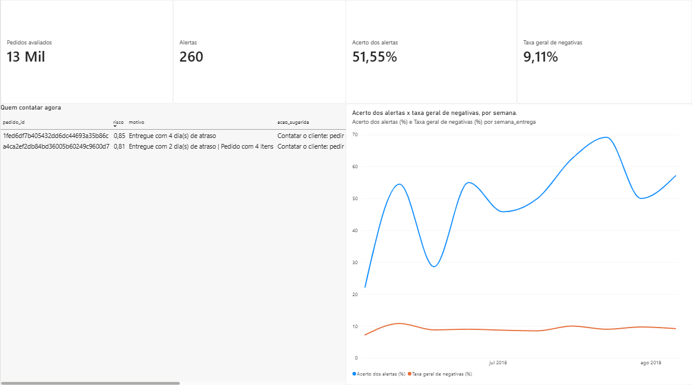
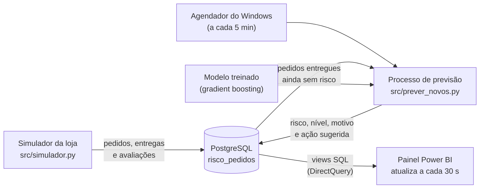

# Monitoramento de risco de pedidos em tempo quase real

> **Um modelo de machine learning funcionando dentro de um banco de dados:** conforme os pedidos de um e-commerce são entregues, o modelo calcula sozinho o risco de cada um receber uma avaliação negativa, grava o resultado no PostgreSQL e um painel no Power BI mostra, ao vivo, quem o atendimento deve contatar e se os alertas estão acertando.

Este projeto coloca em produção o modelo desenvolvido em [**olist-avaliacao-negativa**](https://github.com/igorbicalho88/olist-avaliacao-negativa), que prevê, logo após a entrega, quais pedidos têm alta chance de receber nota 1 ou 2.



## Resumo

- **Pipeline completo:** a "loja" grava pedidos no banco → um processo agendado avalia os pedidos recém-entregues → o resultado volta para o banco → o Power BI mostra tudo, atualizando sozinho a cada 30 segundos.
- **Processamento incremental:** cada execução avalia **só os pedidos novos**, e cada execução fica registrada (quantos pedidos, quantos alertas, sucesso ou erro).
- **Monitoramento do modelo:** quando a avaliação real do cliente chega, o painel confere se o alerta acertou, semana a semana.
- **Mesmo resultado do projeto original:** com os ~19 mil pedidos do período de teste passando pelo banco, as previsões ficaram **100% idênticas** às do modelo original, e **58% dos pedidos em alerta realmente receberam avaliação negativa** (contra 9,7% no geral, ~6x mais certeiro que escolher ao acaso).

---

## 1. Arquitetura



| Componente | O que faz |
|---|---|
| `src/simulador.py` | Faz o papel do sistema da loja: grava no banco, na ordem em que aconteceram, os pedidos reais da Olist do período que o modelo nunca viu. Um relógio simulado avança algumas horas a cada passo: pedidos comprados entram sem data de entrega, são atualizados quando entregues, e as avaliações entram quando o cliente responde. |
| `src/prever_novos.py` | Busca os pedidos **entregues** que **ainda não têm risco**, calcula as 24 variáveis, aplica o modelo e grava o resultado. Registra cada execução na tabela `execucoes` e em `logs/previsoes.log` (inclusive falhas, como banco fora do ar). |
| `src/variaveis.py` | Calcula as variáveis com a mesma lógica do treino do modelo, para evitar diferenças entre treino e produção. |
| `agendar_tarefa.ps1` | Cria a tarefa no Agendador de Tarefas do Windows que roda a previsão a cada 5 minutos, sem abrir janela. Numa empresa, esse papel seria do cron ou do Airflow num servidor. |
| `sql/` | Scripts que criam as tabelas e as views usadas pelo painel. |
| `painel/monitoramento_risco.pbix` | Painel no Power BI conectado ao banco em DirectQuery. |

## 2. Banco de dados

| Tabela | Conteúdo | Quem grava |
|---|---|---|
| `pedidos` | Um pedido por linha: datas (compra, aprovação, envio, prazo, entrega), valores, quantidades, estados, pagamento e categoria. Entra na compra com a entrega vazia. | Loja (simulador) |
| `risco_pedidos` | Risco (0 a 1), nível (alto, médio, baixo), motivo, ação sugerida e versão do modelo. | Modelo |
| `avaliacoes` | Nota dada pelo cliente e data da resposta. | Loja (simulador) |
| `execucoes` | Início, fim, pedidos avaliados, alertas, status e mensagem de erro de cada execução. | Modelo |

| View | Uso |
|---|---|
| `vw_pedidos_risco` | Cada pedido avaliado com o risco e o que aconteceu depois: **acertou**, **alarme falso** ou **aguardando avaliação**. |
| `vw_fila_atendimento` | Pedidos de risco alto ainda sem avaliação: a lista de quem contatar agora. |
| `vw_desempenho_semanal` | Acerto dos alertas e taxa geral de negativas por semana de entrega. |

## 3. O painel

- **Indicadores:** pedidos avaliados, alertas, acerto dos alertas e taxa geral de negativas.
- **Quem contatar agora:** os pedidos em alerta, do maior para o menor risco, com o motivo ("Entregue com 15 dia(s) de atraso", "2 vendedores: pode ter chegado só parte do pedido") e a ação sugerida.
- **Acerto x taxa geral, por semana:** a distância entre as duas linhas mostra o ganho do modelo, e uma queda no acerto seria o sinal para revisar ou retreinar o modelo.

## 4. Decisões de projeto

- **Senha fora do código:** a conexão lê os dados de um arquivo `.env`, que não é versionado (há um `.env.exemplo` como modelo).
- **Versão do scikit-learn fixada** (`1.9.1`), a mesma do treino, porque modelos salvos com joblib podem falhar ou mudar de comportamento em outra versão.
- **Idempotência:** rodar a previsão duas vezes não duplica nada (`ON CONFLICT DO NOTHING` e busca só de pedidos sem risco).
- **Sem vazamento de dados:** o modelo só usa o que é conhecido no momento da entrega; a avaliação do cliente entra no banco depois e serve apenas para monitorar o acerto.
- **DirectQuery no Power BI:** o painel consulta o banco diretamente, sem precisar de nova importação para mostrar os dados mais recentes.

## 5. Como reproduzir

Requisitos: Windows, Python 3.11, PostgreSQL e Power BI Desktop.

1. Clone o repositório e crie o ambiente:

```powershell
python -m venv .venv
.venv\Scripts\activate
pip install -r requirements.txt
```

2. Baixe a base no [Kaggle](https://www.kaggle.com/datasets/olistbr/brazilian-ecommerce) e coloque os CSVs em `data/olist/` (orders, order_items, order_payments, order_reviews, customers, products e sellers).
3. No PostgreSQL, crie o banco `risco_pedidos` e rode `sql/01_criar_tabelas.sql` e `sql/02_views.sql`.
4. Copie `.env.exemplo` para `.env` e preencha a senha do banco. Para testar a conexão: `python src/conexao.py`.
5. Em um terminal, ligue a loja: `python src/simulador.py --loop`
6. Em outro, ligue o modelo: `python src/prever_novos.py --loop --intervalo 15`
   ou agende a cada 5 minutos: `powershell -ExecutionPolicy Bypass -File agendar_tarefa.ps1`
7. Abra `painel/monitoramento_risco.pbix` no Power BI Desktop e informe o usuário e a senha do banco.

Para recomeçar a simulação do zero: `python src/simulador.py --reiniciar`

## 6. Estrutura do projeto

```
monitoramento-risco-pedidos/
├── src/
│   ├── conexao.py          # conexão com o PostgreSQL (lê o .env)
│   ├── simulador.py        # simula a operação da loja
│   ├── variaveis.py        # 24 variáveis do modelo, igual ao treino
│   └── prever_novos.py     # processo de previsão incremental
├── sql/
│   ├── 01_criar_tabelas.sql
│   └── 02_views.sql
├── models/                 # modelo treinado no projeto olist-avaliacao-negativa
├── painel/                 # painel do Power BI (.pbix)
├── docs/                   # imagens deste README
├── agendar_tarefa.ps1      # agenda a previsão no Windows
├── .env.exemplo
└── requirements.txt
```

## 7. Próximos passos

- Rodar em nuvem (PostgreSQL gerenciado e o processo agendado num servidor ou com Airflow).
- Alertar o atendimento automaticamente (e-mail ou mensagem) quando surgir um pedido de risco alto.
- Retreinar o modelo periodicamente e comparar versões pelo acerto semanal, usando a coluna `versao_modelo`.

## 8. Tecnologias

Python · pandas · scikit-learn · SQLAlchemy · psycopg · PostgreSQL · SQL (views) · Power BI (DirectQuery, DAX) · Agendador de Tarefas do Windows · Git

## Autor

**Igor Bicalho**, cientista de dados
[LinkedIn](https://www.linkedin.com/in/igorcbicalho)

*Dados: Olist, disponibilizados publicamente no Kaggle.*
